# AI Workforce – agentic orchestration in Mermaid

The complete orchestration of the new design (see `DESIGN-ORCHESTRATION.md` and `AIW-System-Design.html`), as Mermaid diagrams.
Paste any block into Mermaid (mermaid.ai / mermaid.live), GitHub, or a Markdown viewer that supports Mermaid.

**Colour key** (used in every diagram):

| Colour | Meaning | Cost |
|---|---|---|
| grey | plain code | free |
| green | Haiku | cheap |
| blue | Sonnet | most agent work |
| violet | Opus | planning and coding size M/L work |
| amber | you, or a gate | a decision |

---

## 1. The whole system

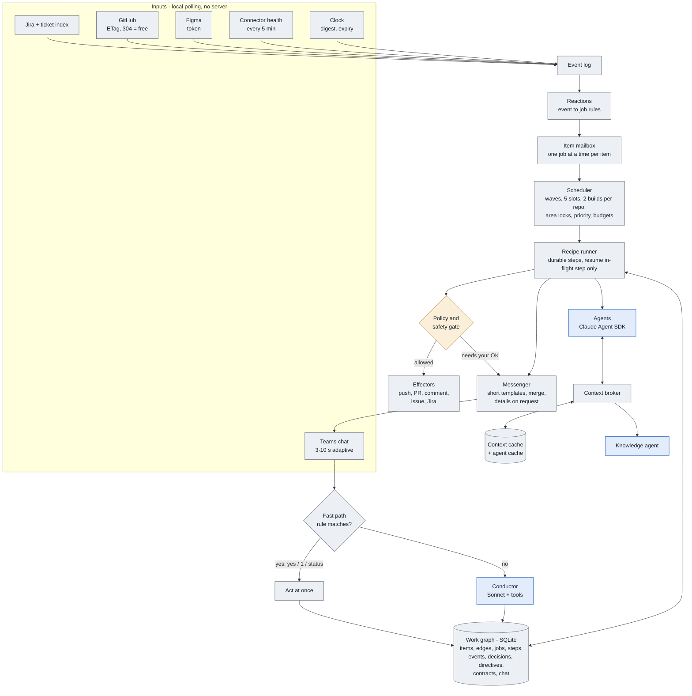

---

## 2. A Teams message: fast path or Conductor

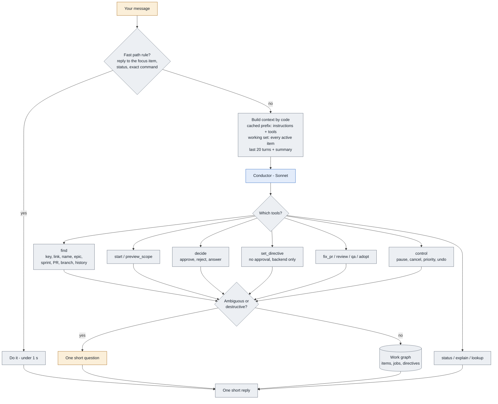

---

## 3. Life of a work item (ticket, part, PR, branch, audit)

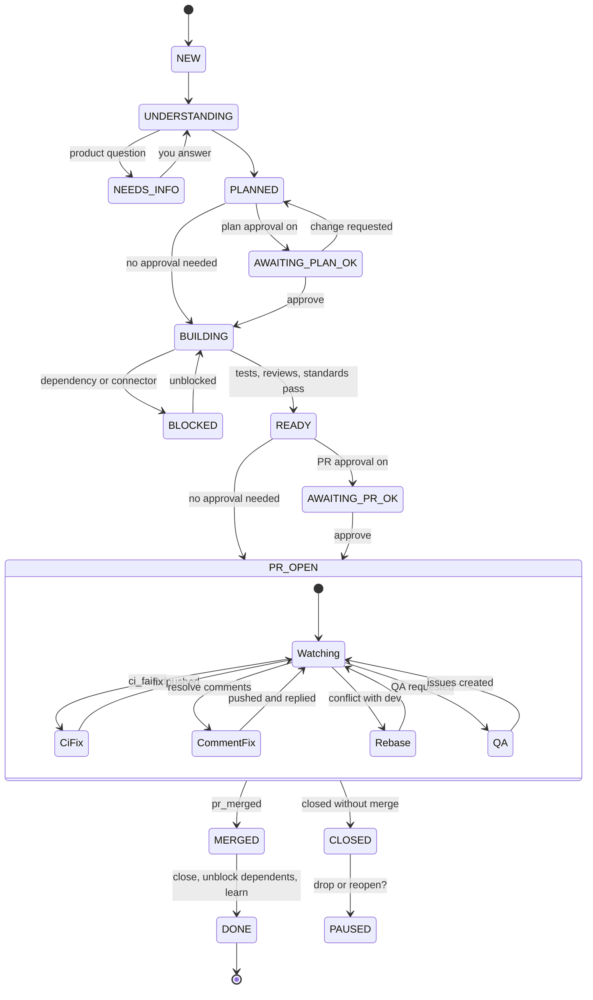

---

## 4. The ticket recipe: code edges and model-chosen branches

Diamonds marked **model** take the branch chosen by an agent's structured answer. Diamonds marked **code** are plain rules.

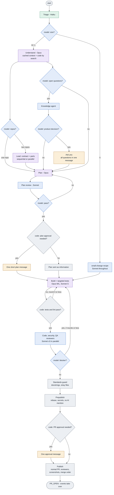

---

## 5. Events drive everything after the request

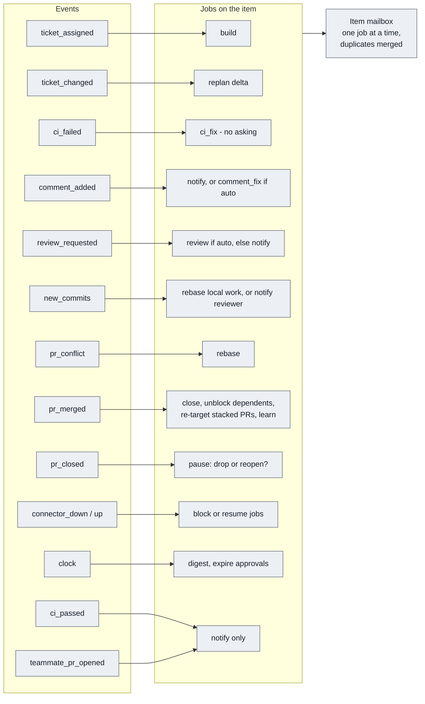

---

## 6. Sprint, epic and batch: hierarchical orchestration

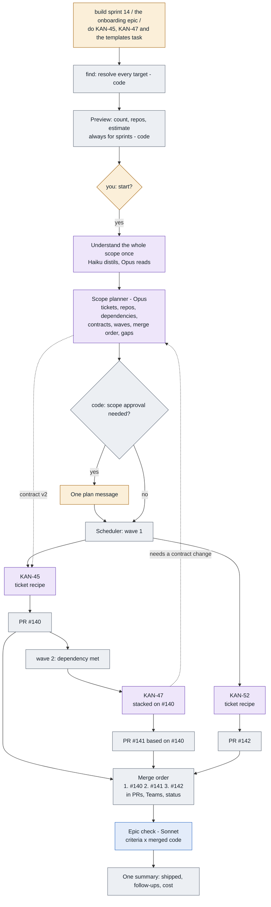

---

## 7. Inside a job: the two routes for every need

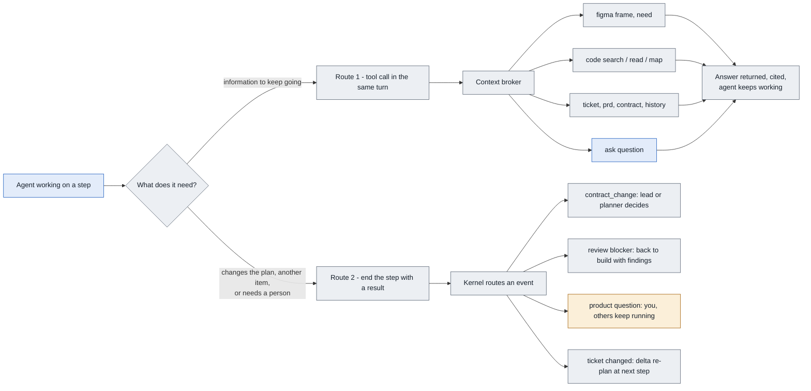

---

## 8. The implementer needs Figma again

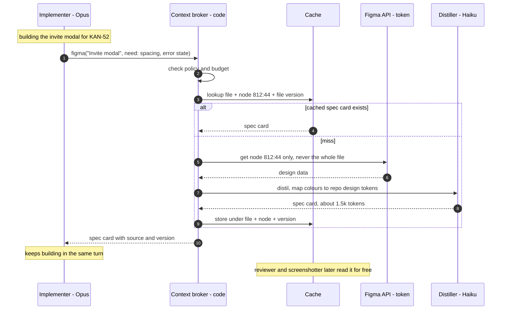

---

## 9. The plugin needs to understand the code again

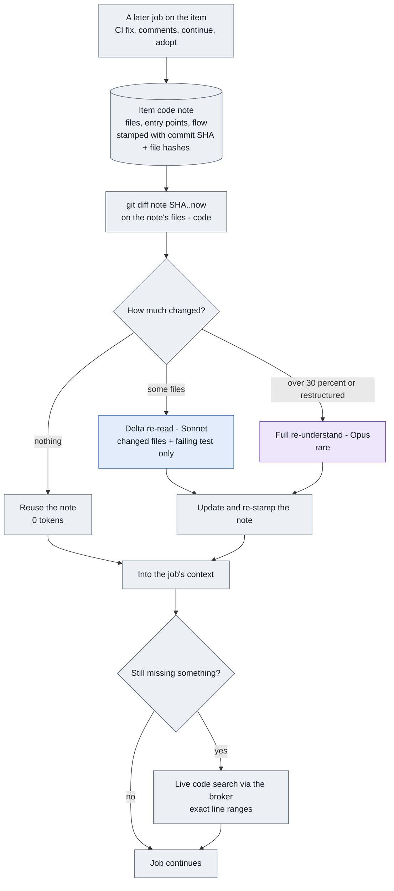

---

## 10. Knowledge agent: ask the data before the human

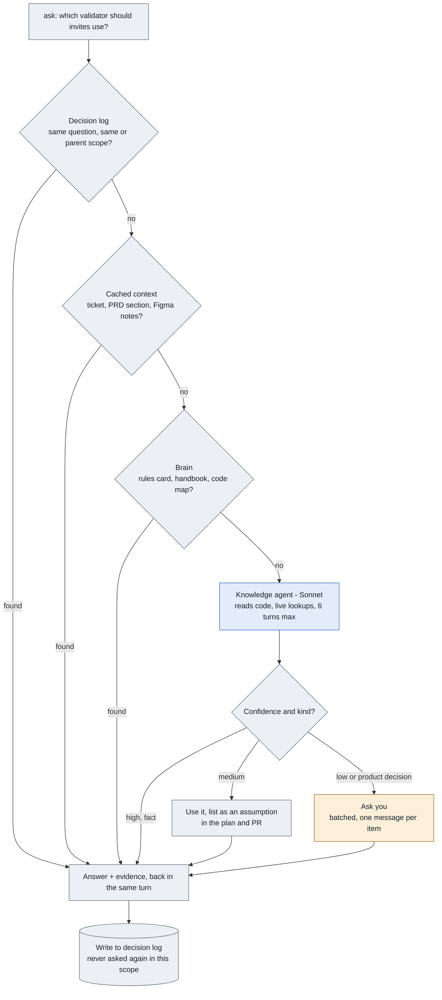

---

## 11. CI fails on a PR the plugin raised

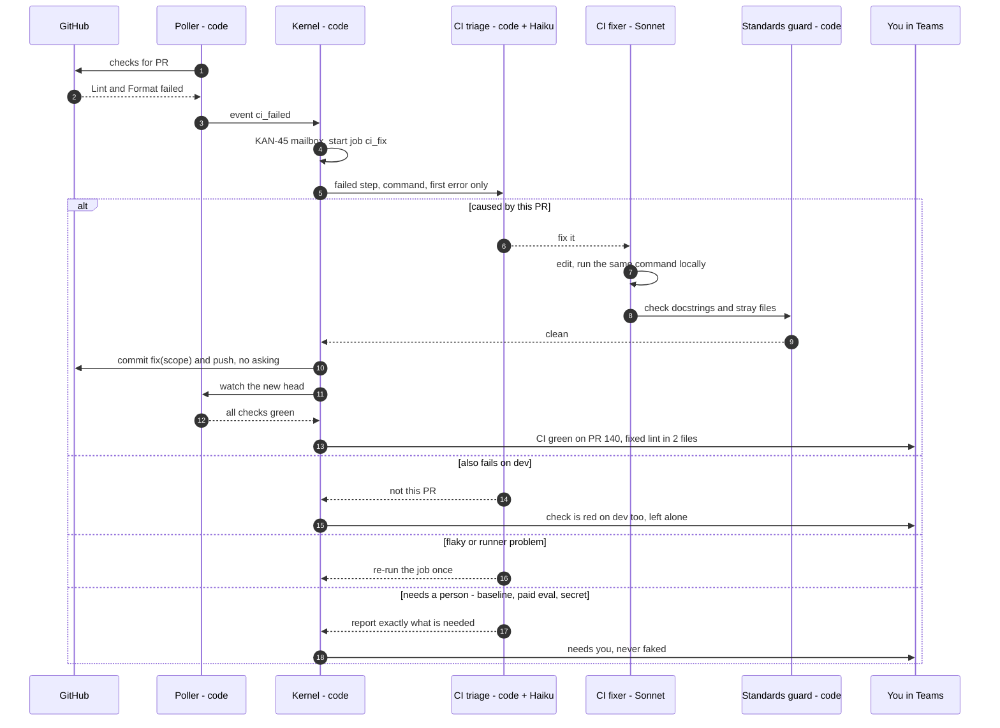

---

## 12. Two developers, two plugins, GitHub in the middle

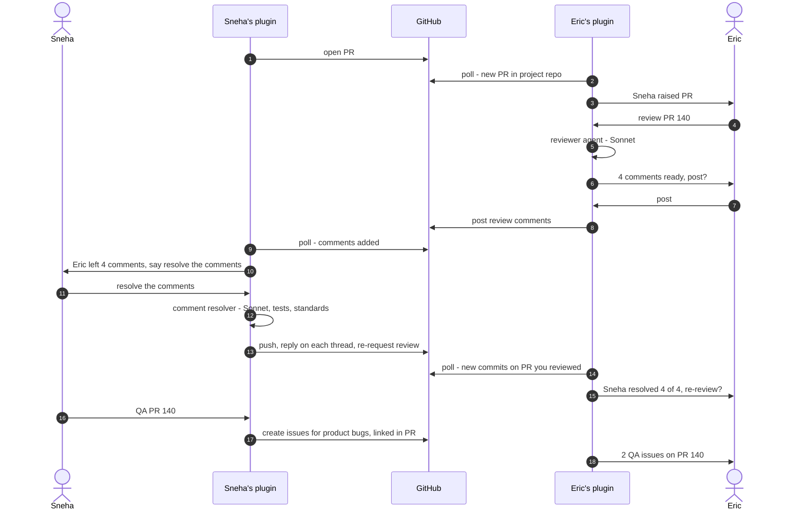

---

## 13. Review a ticket done long ago

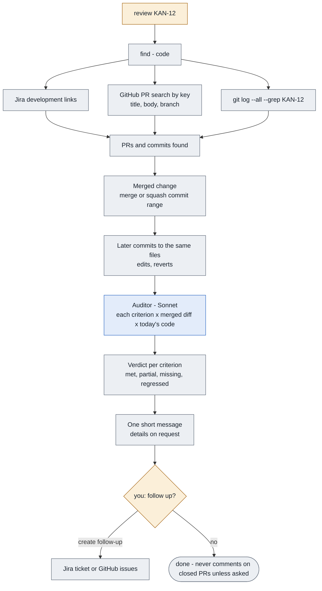

---

## 14. Finish my branch (adopt)

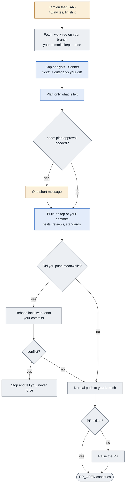

---

## 15. Connector health: Jira, GitHub, Figma always connected

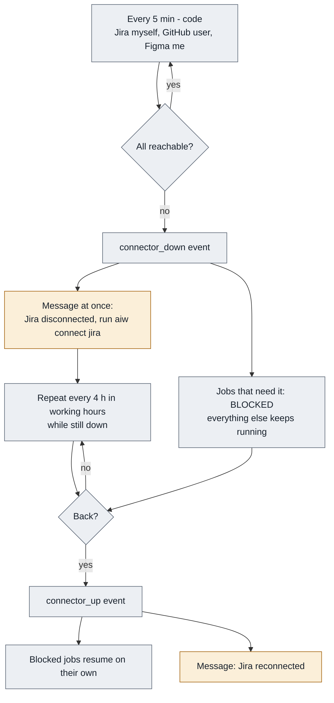

---

## 16. How one agent call is assembled (cost)

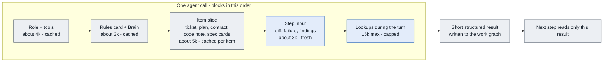
